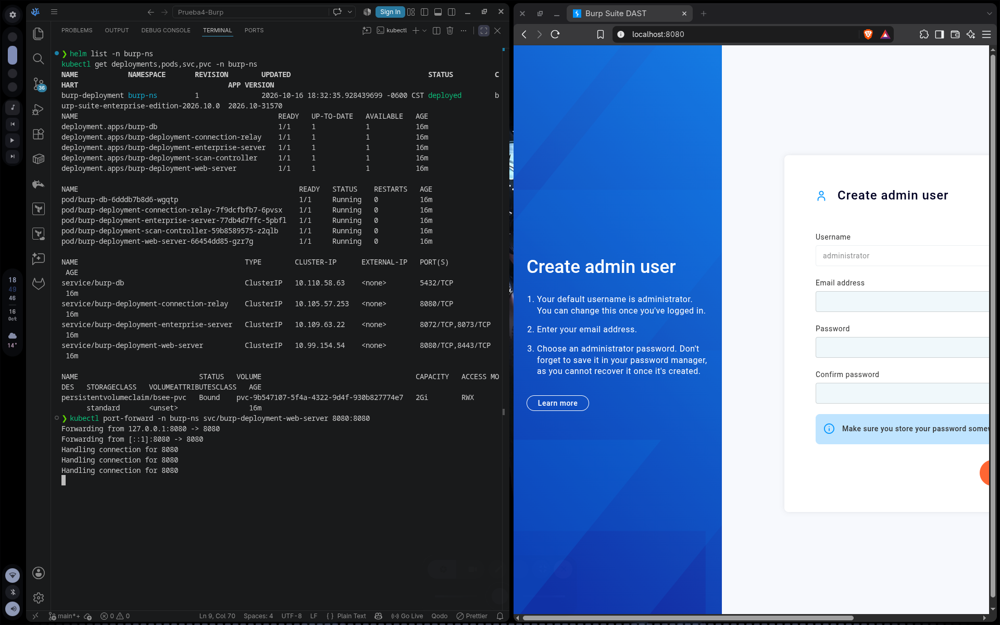
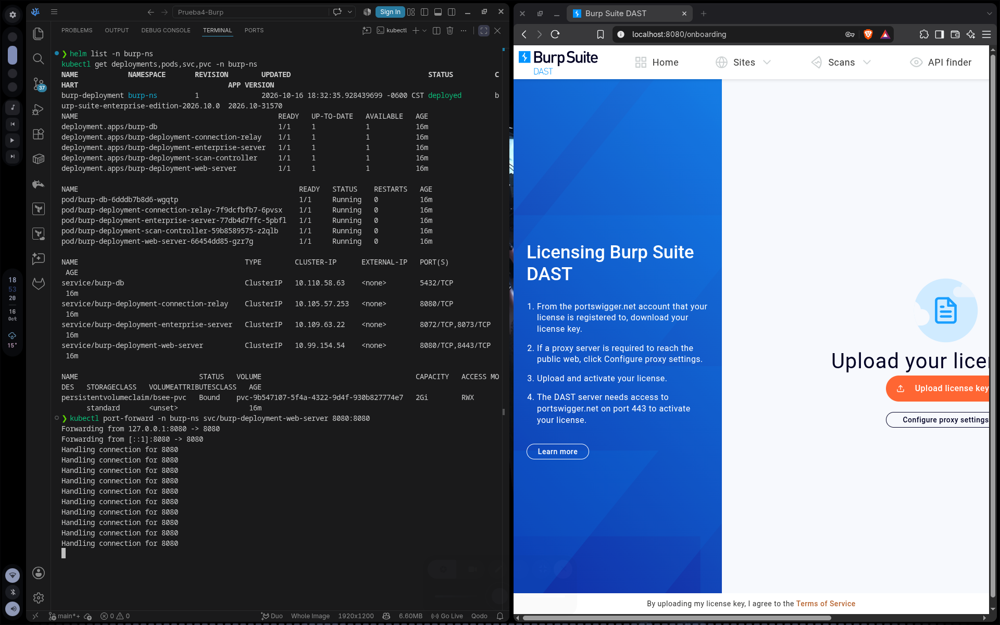

# Prueba4-Burp

Repositorio para la prueba 4 de DevSecOps.

En este repositorio se encuentra el Helm Chart oficial de Burp Suite Enterprise (DAST) junto con la configuración personalizada para desplegarlo en Kubernetes.

El chart incluye la configuración para conectarse a una base de datos externa PostgreSQL (postgres:15) y los volúmenes persistentes requeridos para su ejecución.

Se intuye que ya se tiene instalado helm y kubectl en la máquina host con acceso al clúster de Kubernetes.

## Instrucciones

Para desplegar la aplicación completa en Kubernetes bastaría con ejecutar el siguiente comando en la terminal:

```bash
helm install -n burp-ns burp-deployment ./burp -f values.yml --create-namespace
```

Una vez ejecutado, esperamos a que los pods terminen de levantarse y podemos verificar el estado de los despliegues, pods y servicios con:

```bash
helm list -n burp-ns
kubectl get deployments,pods,svc,pvc -n burp-ns
```

Para validar el funcionamiento del servidor web, exponemos el servicio del web server con:

```bash
kubectl port-forward -n burp-ns svc/burp-deployment-web-server 8080:8080
```

Una vez hecho eso ya estaría corriendo el servidor web y podemos ver la respuesta visitando http://localhost:8080 en el navegador para ver la consola de Burp Suite Enterprise Edition levantada.

Para desinstalar la aplicación y limpiar los recursos del clúster ejecutamos:

```bash
helm uninstall -n burp-ns burp-deployment
kubectl delete namespace burp-ns
```

## Evidencias de funcionamiento

Evidencia de los pods, deployments y servicios corriendo en estado `Running` y la consola web de burp





